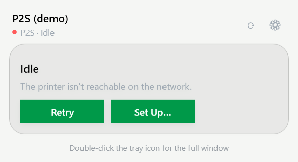
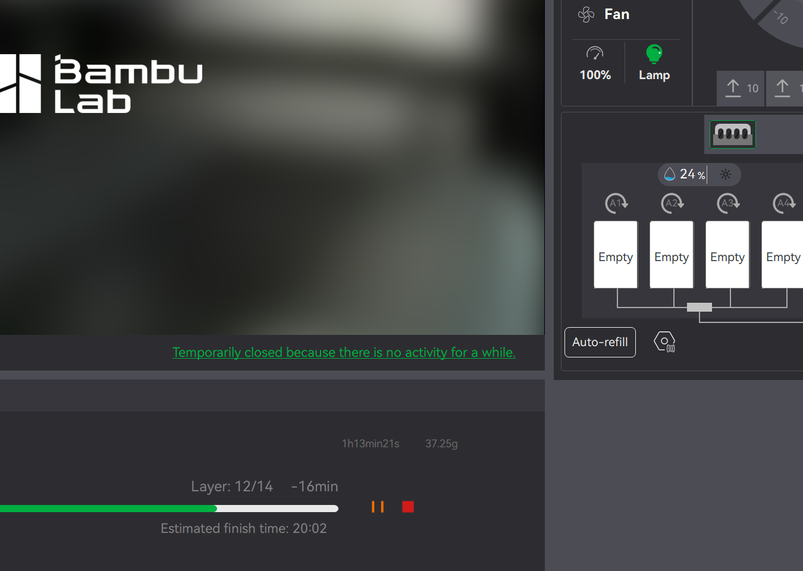
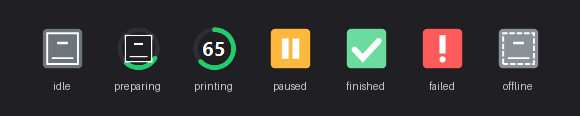

# Bambu Bar for Windows

A native Windows port of [bambu-bar](https://github.com/rolottr/bambu-bar) — a menu-bar-style
companion for Bambu Lab P2-series printers (P2S and up). It lives in the system tray, shows live
print status (progress, temperatures, layers, AMS/spool filament), and lets you pause, resume,
stop and change print speed without leaving the printer's own app.

Built with C# / .NET 8 / WPF. No cloud, no account, no analytics — it talks only to your printer
over the printer's own MQTT interface.

## Screenshots

| Mini panel (double-click the tray icon) | Main window |
| --- | --- |
|  |  |

The tray icon reflects the current print state:



All screenshots were captured in `--demo` mode (built-in fake printer, no network).

## Building

Requires the [.NET 8 SDK](https://dotnet.microsoft.com/download/dotnet/8.0) (Windows 10/11).

```sh
dotnet build -c Release
```

The app is at `src/BambuBar.App/bin/Release/net8.0-windows/BambuBar.exe`. To ship a single
folder without the SDK:

```sh
dotnet publish src/BambuBar.App -c Release -r win-x64 --self-contained false
```

## Using it

| Command | What it does |
| --- | --- |
| `BambuBar.exe` | Normal start: tray icon + main window, remembers your printers. |
| `BambuBar.exe --connect <ip> <serial> <access-code>` | Start and immediately connect to a printer. |
| `BambuBar.exe --probe <ip> <serial> <access-code> [seconds]` | Diagnostics: connect, request a full report, print what the printer says, then stop. Remove the serial and access code before posting output anywhere. |
| `BambuBar.exe --demo [scenario]` | Run against a built-in fake printer (`printing`, `paused`, `finished`, `failed`, …). No network. |
| `BambuBar.exe --tray` | Start minimized to the tray. |
| `BambuBar.exe --help` / `--version` | Self-explanatory. |

The access code is the one shown on the printer's screen (Settings → Network / Wi-Fi page). It is
stored in the **Windows Credential Manager** — never in plain text — and only ever sent to the
printer.

Slicer imports (Bambu Studio / Orca Slicer) read `%APPDATA%\<Slicer>\config\*.conf`.
App settings live under `%APPDATA%`.

## Security model

The macOS original's trust model is preserved:

- **TLS only, pinned to 1.2** — the P2S firmware does not answer TLS 1.3, so the client pins 1.2
  and never silently downgrades.
- **Bundled Bambu Lab roots only** — the server certificate must chain to one of the Bambu roots
  shipped inside the app (`BambuBar.Core/Resources/certificates/`). The Windows certificate store
  is never consulted, so a local CA or a rogue `bambulab.com` name cannot impersonate a printer.
- **Leaf certificate CN must equal the printer's serial number** — a valid Bambu-signed cert for a
  *different* device is rejected as "belongs to another device".
- **MQTT user `bblp` + your access code** on TCP 8883, clean session; the printer refuses wrong
  codes (CONNACK 4/5) and anonymous clients outright.
- **Access code at rest** lives in the Windows Credential Manager (LPSTR credential, per-user),
  not in the settings file.

`--insecure-tls` skips the certificate evaluation (the bundled roots are not applied). It exists
for the local emulator below and should not be used against a real printer.

> DMZ note: this app is intended for a trusted printer LAN segment. It opens no inbound ports and
> initiates only outbound connections to a printer you have explicitly added.

## Printer emulator (dev/test)

A self-contained fake P2S for developing without hardware — a Python re-implementation of the
macOS repo's `scripts/emulator/printer.py` (no mosquitto binary needed): the broker is [amqtt],
the printer side [paho-mqtt], and the self-signed CA/server cert (CN = `22E00EMULATOR0`) are
generated with [`cryptography`].

```sh
pip install amqtt paho-mqtt cryptography
python tools/emulator/printer.py
```

It serves on `127.0.0.1:8883`, user `bblp`, access code `12345678`, streams a realistic print
(PREPARE → RUNNING → progress/temperatures/layers) and answers pause/resume/stop/speed/light.
The broker enforces the same auth rules as a real printer: anonymous and wrong-code connections
are refused (verified against the broker's own decision log).

```sh
BambuBar.exe --probe 127.0.0.1 22E00EMULATOR0 12345678 10
BambuBar.exe --connect 127.0.0.1 22E00EMULATOR0 12345678 --insecure-tls
```

## Layout

```
BambuBar.sln
src/
  BambuBar.Core/     protocol (MQTT, trust, report parsing), store, sessions, demo/probe
  BambuBar.App/      WPF UI: tray, main window, pages, CLI entry point
tools/
  emulator/          self-contained fake P2S (dev-only; not part of the app)
```

## Credits & license

This project is a Windows port of [rolottr/bambu-bar](https://github.com/rolottr/bambu-bar),
licensed under the MIT License. The original macOS app, its design language, and the Bambu Lab
MQTT protocol knowledge are © rolottr. Protocol sample report from
[ha-bambulab](https://github.com/greghesp/ha-bambulab) (MIT). The Windows port was developed
with AI assistance (Qwen3 27B via LM Studio Bionic).

See [LICENSE](LICENSE) for the full text.

[amqtt]: https://github.com/mosquito/amqtt
[paho-mqtt]: https://github.com/eclipse-paho/paho.mqtt.python
[`cryptography`]: https://cryptography.io/
